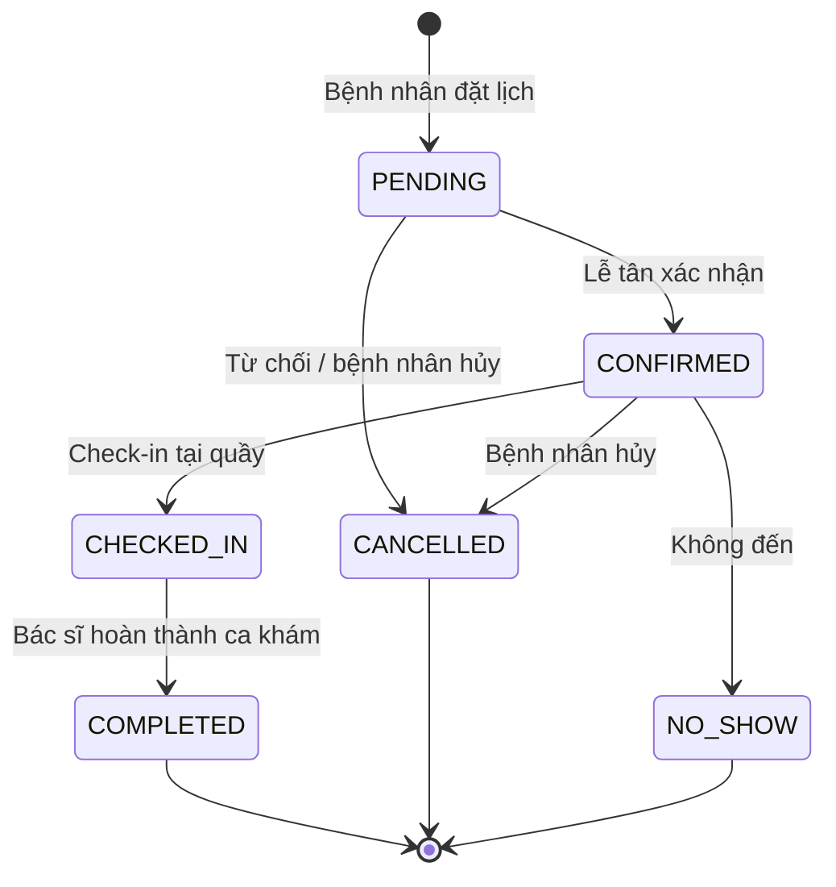
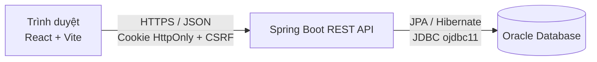

<div align="center">

# 🏥 Hệ thống Đặt lịch Khám bệnh — Bệnh viện Nam Lương Sơn

**Nền tảng web đặt lịch khám trực tuyến, quản lý lịch làm việc bác sĩ, tiếp đón – thanh toán và thống kê cho bệnh viện.**


</div>

---

## 📖 Giới thiệu

Đây là đồ án xây dựng hệ thống **đặt lịch khám bệnh trực tuyến**, giúp bệnh nhân chủ động chọn **chuyên khoa → bác sĩ → khung giờ** phù hợp, đồng thời cung cấp các cổng làm việc riêng cho **bác sĩ**, **lễ tân** và **quản trị viên** để vận hành toàn bộ quy trình khám: xác nhận lịch, tiếp đón (check-in), khám, lập phiếu kết quả, thanh toán và thống kê.

Dự án được tổ chức theo mô hình **monorepo**:

```
datlichkhambenh/
├── backend/    # REST API — Spring Boot 4 + Oracle
└── frontend/   # Giao diện web — React 19 + Vite
```

## ✨ Tính năng chính

### 👤 Bệnh nhân
- Đăng ký / đăng nhập, quản lý hồ sơ cá nhân, đổi mật khẩu.
- Xem danh sách **chuyên khoa**, **bác sĩ**, **dịch vụ y tế**; xem chi tiết bác sĩ.
- **Đặt lịch khám** theo chuyên khoa, bác sĩ, ngày và khung giờ còn trống (mỗi khung 30 phút).
- Xem và **hủy lịch hẹn** của mình; xem **kết quả khám** đã phát hành; xem **lịch sử thanh toán**.

### 🩺 Bác sĩ
- Bảng điều khiển với thống kê cá nhân.
- Xem danh sách lịch hẹn được phân công, **hoàn thành** ca khám.
- Tự đăng ký **lịch làm việc** theo thứ trong tuần và ca (cả ngày / sáng / chiều / nghỉ).
- Soạn **phiếu kết quả khám** (bản nháp → phát hành).

### 🧾 Lễ tân
- Xem lịch hẹn trong ngày / theo ngày; **xác nhận, từ chối, check-in, đánh dấu vắng mặt**.
- Đặt lịch hộ bệnh nhân, tra cứu danh sách bệnh nhân.
- Thêm **dịch vụ phát sinh** vào lượt khám và **lập thanh toán** (tiền mặt, chuyển khoản, thẻ, VNPay).

### 🛠️ Quản trị viên
- Quản lý **người dùng**, **bác sĩ**, **chuyên khoa**, **dịch vụ y tế**.
- Duyệt / điều chỉnh **lịch làm việc** của bác sĩ.
- Xem toàn bộ **phiếu kết quả khám**.
- **Cấu hình hệ thống** (key–value) ngay trên giao diện.
- **Dashboard thống kê**: lượt đặt lịch, doanh thu, tỷ lệ hủy, bác sĩ nổi bật.

## 🔄 Vòng đời lịch hẹn



## 🏗️ Kiến trúc



- **Xác thực:** JWT lưu trong **cookie `HttpOnly`** (`access_token`), phiên **stateless**.
- **Chống CSRF:** cơ chế *double-submit cookie* (`XSRF-TOKEN` ↔ header `X-XSRF-TOKEN`).
- **Phân quyền:** 4 vai trò `PATIENT`, `DOCTOR`, `STAFF`, `ADMIN` — kiểm soát ở cả API (Spring Security) lẫn giao diện (`RequireRole`).
- **Mật khẩu:** băm bằng BCrypt.
- **Khởi tạo admin:** tự tạo tài khoản quản trị lần chạy đầu từ biến cấu hình (`AdminBootstrap`).

## 🧰 Công nghệ sử dụng

| Lớp | Công nghệ |
|---|---|
| Backend | Java 17, Spring Boot 4.1, Spring Web MVC, Spring Security, Spring Data JPA, Bean Validation, JJWT 0.12, Lombok |
| Cơ sở dữ liệu | Oracle Database (ojdbc11), khóa chính sinh bằng **SEQUENCE** |
| Frontend | React 19, React Router 7, Vite 8, Axios, Lucide React, ESLint 10 |
| Build | Maven (Maven Wrapper), npm |

## 📁 Cấu trúc thư mục

<details>
<summary><b>Backend</b> — <code>backend/src/main/java/vn/namluongson/datlichkhambenhv</code></summary>

```
config/security/   # SecurityConfig, JWT filter/provider, cookie, AdminBootstrap
controller/        # REST controllers (Auth, Appointment, Doctor, Payment, Statistics, ...)
domain/
  ├─ entities/     # Appointment, Doctor, Department, Payment, ExamReport, ...
  ├─ enums/        # Role, AppointmentStatus, TimeSlot, ShiftType, PaymentMethod, ...
  ├─ dtos/         # requests / responses
  └─ response/     # ApiResponse, PageResponse
exception/         # BusinessException, GlobalExceptionHandler
repository/        # Spring Data JPA repositories (+ custom DoctorRepositoryImpl)
service/           # interfaces/ + impl/
util/              # tiện ích
```
</details>

<details>
<summary><b>Frontend</b> — <code>frontend/src</code></summary>

```
components/   # common, home, layout
layouts/      # Public, Account, Doctor, Reception, Admin
pages/        # public, auth, patient, doctor, reception, admin, account
services/     # lớp gọi API (api.js + từng service theo nghiệp vụ)
config/       # thông tin bệnh viện
utils/        # date, paging, slug, roleHome, ...
```
</details>

## 🔌 Tổng quan API

> Base URL mặc định khi chạy local: `http://localhost:8080`

| Nhóm | Endpoint tiêu biểu | Quyền |
|---|---|---|
| Xác thực | `GET /auth/csrf`, `POST /auth/login`, `POST /auth/register`, `POST /auth/logout` | Công khai |
| Danh mục | `GET /department/*`, `GET /doctor/*`, `GET /medical-services/*` | Công khai (đọc) · `ADMIN` (ghi) |
| Lịch hẹn | `POST /appointment`, `GET /appointment/available-slots`, `GET /appointment/my`, `POST /appointment/my/{uuid}/cancel` | Bệnh nhân |
| Xử lý lịch | `PATCH /appointment/{uuid}/confirm \| check-in \| no-show \| reject \| complete`, `GET /appointment/staff/today`, `GET /appointment/doctor/my` | Lễ tân / Bác sĩ / Admin |
| Giờ làm việc | `POST /doctor-working-hour`, `PUT /doctor-working-hour/my/{dayOfWeek}/{shiftType}`, `PUT /doctor-working-hour/{uuid}/status` | Admin / Bác sĩ |
| Kết quả khám | `POST /exam-reports`, `PATCH /exam-reports/{uuid}/issue`, `GET /exam-reports/doctor/my`, `GET /exam-reports/patient/my` | Bác sĩ / Bệnh nhân |
| Thanh toán | `POST /payments`, `GET /payments/appointment/{uuid}`, `GET /payments/my` | Lễ tân / Bệnh nhân |
| Dịch vụ phát sinh | `/appointment-services/**` | Lễ tân / Admin |
| Người dùng | `GET/POST/PUT/DELETE /user/**`, `POST /admin/staff`, `GET/PUT /me`, `POST /me/change-password` | Admin / Đã đăng nhập |
| Thống kê | `GET /admin/statistics/appointments \| revenue \| cancellations \| top-doctors` | Admin |
| Cấu hình | `GET/POST/PUT/DELETE /admin/configs` | Admin |

## 🚀 Chạy dự án trên máy cá nhân

### Yêu cầu
- **JDK 17+**
- **Node.js 20+** và npm
- Một **Oracle Database** truy cập được 

### 1. Clone

```bash
git clone https://github.com/AnhLove/datlichkhambenh.git
cd datlichkhambenh
```

### 2. Backend

Tạo file `backend/src/main/resources/application.properties`

```properties
server.port=8080

# --- Oracle ---
spring.datasource.url=jdbc:oracle:thin:@//<HOST>:1521/<SERVICE_NAME>
spring.datasource.username=<DB_USER>
spring.datasource.password=<DB_PASSWORD>

# --- JWT ---
jwt.secret=<chuoi-bi-mat-dai-it-nhat-32-ky-tu>
jwt.expiration=86400000

# --- CORS & Cookie ---
app.cors.allowed-origins=http://localhost:5173
app.auth.cookie-secure=false
app.auth.cookie-same-site=Lax

# --- Tài khoản admin khởi tạo lần đầu ---
app.bootstrap.admin-email=admin@example.com
app.bootstrap.admin-phone=0900000000
app.bootstrap.admin-password=<mat-khau-tu-8-ky-tu>
```

Chạy:

```bash
cd backend
./mvnw spring-boot:run        # Windows: mvnw.cmd spring-boot:run
```

### 3. Frontend

```bash
cd frontend
cp .env.example .env          # VITE_API_BASE_URL=http://localhost:8080
npm install
npm run dev                   # http://localhost:5173
```

## ⚙️ Biến môi trường

| Biến (Spring property) | Tương đương biến môi trường | Ý nghĩa |
|---|---|---|
| `spring.datasource.url` | `SPRING_DATASOURCE_URL` | Chuỗi kết nối JDBC Oracle |
| `spring.datasource.username` | `SPRING_DATASOURCE_USERNAME` | Tài khoản DB |
| `spring.datasource.password` | `SPRING_DATASOURCE_PASSWORD` | Mật khẩu DB |
| `jwt.secret` | `JWT_SECRET` | Khóa ký JWT |
| `jwt.expiration` | `JWT_EXPIRATION` | Thời hạn token (ms) |
| `app.cors.allowed-origins` | `APP_CORS_ALLOWED_ORIGINS` | Danh sách origin frontend được phép |
| `app.auth.cookie-secure` | `APP_AUTH_COOKIE_SECURE` | `true` khi chạy HTTPS |
| `app.auth.cookie-same-site` | `APP_AUTH_COOKIE_SAME_SITE` | `Lax` / `None` / `Strict` |
| `app.bootstrap.admin-*` | `APP_BOOTSTRAP_ADMIN_EMAIL/PHONE/PASSWORD` | Tài khoản admin khởi tạo |
| *(frontend)* `VITE_API_BASE_URL` | — | URL gốc của API |

## ☁️ Triển khai

- **Backend:** đóng gói thành file JAR bằng `./mvnw clean package -DskipTests`, chạy bằng `java -jar backend/target/*.jar` (cần JDK 17+ và biến môi trường như bảng trên).
- **Frontend:** build tĩnh bằng `npm run build` (thư mục `dist/`), có thể host trên bất kỳ dịch vụ tĩnh nào.
- Khi frontend và backend khác domain, cookie xác thực và CSRF cần được cấu hình cẩn thận: cookie `XSRF-TOKEN` do backend đặt phải đọc được từ frontend, vì vậy nên đặt hai bên sau cùng một domain (reverse proxy) hoặc dùng subdomain cùng domain gốc.

## 🗺️ Định hướng phát triển

- [ ] Tích hợp cổng thanh toán trực tuyến (VNPay) cho bệnh nhân
- [ ] Gửi email / SMS nhắc lịch hẹn
- [ ] Script khởi tạo schema Oracle (DDL + sequence) và dữ liệu mẫu
- [ ] CI/CD (GitHub Actions) và kiểm thử tự động
- [ ] Tài liệu API với OpenAPI / Swagger

## 👨‍💻 Tác giả

**Trần Văn Tuấn Anh** — [@AnhLove](https://github.com/AnhLove)

Đồ án phục vụ học tập. Mọi góp ý xin gửi qua [Issues](https://github.com/AnhLove/datlichkhambenh/issues).
